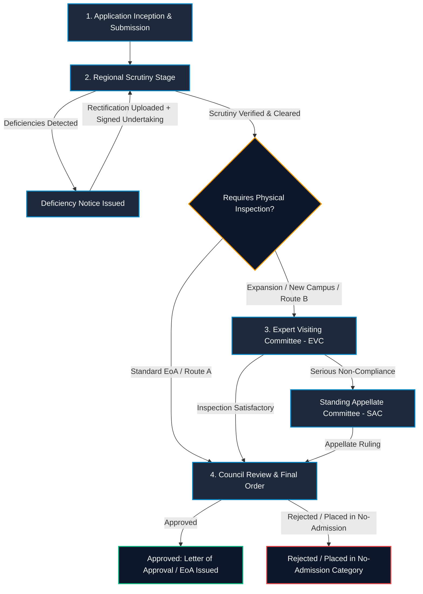
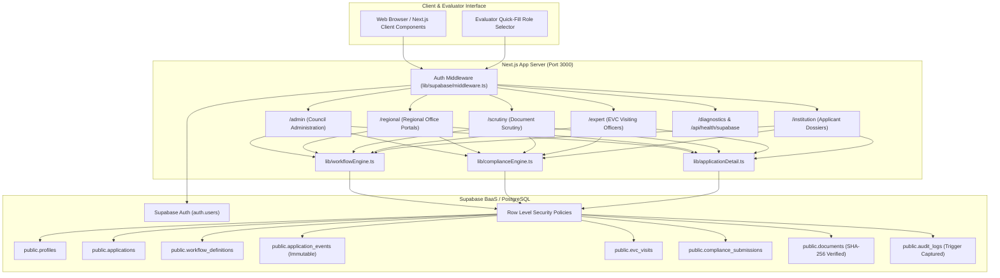

# AICTE SAKSHAM — Smart Approval, Compliance, Scheduling, and Handling Automation Management System

[](https://nextjs.org/)
[](https://react.dev/)
[](https://www.typescriptlang.org/)
[](https://tailwindcss.com/)
[](https://supabase.com/)

> **Smart India Hackathon 2026** • Problem Statement ID: **26262**  
> **Tagline:** *Empowering Institutions. Streamlining Approvals.*  
> An automated governance engine modernizing statutory technical education clearances, continuous compliance monitoring, and automated deadline escalations under the AICTE Approval Process Handbook (APH 2026–27).

---

## Table of Contents

- [1. Executive Summary](#1-executive-summary)
- [2. Problem Statement](#2-problem-statement)
- [3. Proposed Solution & Value Delivered](#3-proposed-solution--value-delivered)
- [4. Implemented Feature Matrix](#4-implemented-feature-matrix)
- [5. Role-Based Access Control (RBAC)](#5-role-based-access-control-rbac)
- [6. Application Lifecycle & Statutory Workflows](#6-application-lifecycle--statutory-workflows)
- [7. System Architecture](#7-system-architecture)
- [8. Verified Technology Stack](#8-verified-technology-stack)
- [9. Repository Structure](#9-repository-structure)
- [10. Prerequisites & Local Setup](#10-prerequisites--local-setup)
- [11. Environment Configuration](#11-environment-configuration)
- [12. Supabase Database & Security Setup](#12-supabase-database--security-setup)
- [13. Evaluator Test Accounts & Workflow Demonstration](#13-evaluator-test-accounts--workflow-demonstration)
- [14. Verification Commands (Lint, Build, Start)](#14-verification-commands-lint-build-start)
- [15. Security Hardening & Audit Controls](#15-security-hardening--audit-controls)
- [16. Known Limitations & Roadmap](#16-known-limitations--roadmap)
- [17. Screenshots & Interface Preview](#17-screenshots--interface-preview)
- [18. Contributing & Code Quality](#18-contributing--code-quality)
- [19. License & Project Disclaimer](#19-license--project-disclaimer)

---

## 1. Executive Summary

**AICTE SAKSHAM** (**S**mart **A**pproval, **C**ompliance, **S**cheduling, and **H**andling **A**utomation **M**anagement System) is an enterprise-grade statutory governance platform engineered to automate and govern the end-to-end institutional approval lifecycle for technical education institutions across India. Built on Next.js 16 (Turbopack, SSR, App Router) and PostgreSQL (Supabase), the system transitions AICTE approvals from opaque, multi-stage paper bureaucracy into a verifiable, audit-logged digital pipeline.

The platform unifies **statutory multi-tenant role authentication**, **rule-based workflow dispatch**, **dynamic compliance monitoring**, **Expert Visiting Committee (EVC) audit tracking**, **geotagged field reports**, **digital legal undertakings**, and an **explainable deadline risk radar** with automated Bureau escalations.

---

## 2. Problem Statement

Technical institutions seeking Extension of Approval (EoA), New Program Sanctions, or Capacity Expansion under AICTE face complex regulatory requirements:

1. **Opaque Multi-Stage Bureaucracy:** Tracking dossiers across institutional submissions, regional scrutiny, EVC visits, and Executive Council endorsements causes opacity and administrative delay.
2. **Deficiency Resolution Bottlenecks:** Deficiencies raised during scrutiny or field inspections often stall without transparent evidence submission, resulting in missed academic calendar deadlines.
3. **SLA Violations Without Accountability:** Manual tracking fails to proactively alert regional and national council officers before statutory turnaround timeframes expire.
4. **Data Integrity & Audit Deficits:** Regulatory decisions require non-repudiable audit logs, tamper-evident record keeping, and verified legal undertakings from institutional heads.

---

## 3. Proposed Solution & Value Delivered

AICTE SAKSHAM solves these challenges through five core mechanisms:

- **Configured Statutory Routing:** Dynamically steers applications through predefined legal tracks (Scrutiny Only, Scrutiny + EVC, EVC + SAC Appeal, and Surprise Audit) mapped to AICTE APH 2026–27 guidelines.
- **Deadline Risk Radar & Bureau Escalations:** Computes real-time SLA burn rates per stage, categorizing items into `ON_TRACK`, `UPCOMING`, `DUE_NOW`, and `OVERDUE` with multi-tier notification escalation triggers.
- **Case Flight Recorder:** Provides an append-only timeline of transitions (`application_events` and `audit_logs`) recording stage changes, reviewer remarks, timestamps, and actor UUIDs.
- **Continuous Compliance & Undertakings Hub:** Manages deficiency notices, rectifications with SHA-256 verified document artifacts, and digitally signed institutional affidavits.
- **SIH Simulation Lab & Time Machine:** Enables evaluators to fast-forward time horizons (+5 to +30 days) and simulate critical SLA breaches, deficiency rollbacks, and EVC anomalies without compromising production integrity.

---

## 4. Implemented Feature Matrix

The following features are **fully implemented and verified in the source code**:

| Feature Component | Implementation Status | Codebase Anchor | Description |
| :--- | :---: | :--- | :--- |
| **Multi-Tenant SSR Auth & RBAC** | ✅ Implemented | `lib/supabase/middleware.ts`, `lib/authContext.ts` | Cookie-based session tokens with role claims derived from `public.profiles`. |
| **National Council Admin Dashboard** | ✅ Implemented | `app/admin/page.tsx`, `components/admin/` | High-level metrics, active applications table, filterable search, and flight recorder. |
| **Statutory Workflow Routes** | ✅ Implemented | `app/admin/workflows/page.tsx`, `lib/workflowEngine.ts` | 4 statutory tracks: `SCRUTINY_ONLY`, `SCRUTINY_EVC`, `EVC_SAC`, `ONLY_EVC`. |
| **Live Deadline Risk Radar** | ✅ Implemented | `components/admin/DeadlineRiskRadar.tsx` | SLA countdown, severity flagging (`low`, `medium`, `high`, `critical`), and automated reminders. |
| **Application Detail Dossier** | ✅ Implemented | `app/admin/applications/[id]/page.tsx` | Comprehensive view of institutional data, timeline events, evidence docs, and tasks. |
| **Workflow Action Dispatch Panel** | ✅ Implemented | `components/admin/WorkflowActionPanel.tsx` | Stage transition controls: Approve, Reject, Return with Deficiencies, or Schedule EVC. |
| **Compliance & Deficiency Center** | ✅ Implemented | `app/admin/compliance/page.tsx`, `lib/complianceEngine.ts` | Tracks deficiency notices, institutional replies, and legal undertaking signatures. |
| **EVC Expert Visit Management** | ✅ Implemented | `app/admin/evc-visits/page.tsx`, `components/admin/EvcManagementView.tsx` | Manages scheduled visits, rubric scores, lead expert assignments, and inspection summaries. |
| **SIH 2026 Simulation Lab** | ✅ Implemented | `app/admin/simulation/page.tsx`, `components/admin/SihSimulationLabView.tsx` | Interactive sandbox for testing stress scenarios, SLA breaches, and workflow transitions. |
| **Time Machine Context** | ✅ Implemented | `components/admin/TimeMachineContext.tsx` | In-memory simulated clock for live evaluation of SLA deadlines. |
| **Role-Specific Dedicated Portals** | ✅ Implemented | `app/regional/`, `app/scrutiny/`, `app/expert/`, `app/institution/` | Scoped dashboards customized for each authorized stakeholder persona. |
| **Supabase Health Diagnostics** | ✅ Implemented | `app/diagnostics/page.tsx`, `app/api/health/supabase/route.ts` | Real-time connectivity check for database latency and authentication readiness. |
| **Immutable Audit Ledger** | ✅ Implemented | `app/admin/audit-logs/page.tsx` | PostgreSQL-backed append-only audit trail logging user operations and table events. |

---

## 5. Role-Based Access Control (RBAC)

AICTE SAKSHAM enforces role boundaries at both the server middleware layer and within PostgreSQL Row Level Security (RLS) policies:

| Role Title | Canonical Key | Primary Dashboard Route | Scope of Authority & Operational Responsibilities |
| :--- | :--- | :--- | :--- |
| **Council Admin** | `council_admin` | `/admin` | National regulatory oversight, Executive Council approvals, SLA Risk Radar, and nationwide analytics. |
| **Regional Officer** | `regional_officer` | `/regional` | Jurisdictional management, assigning scrutiny officers, and coordinating regional EVC inspection rosters. |
| **Scrutiny Officer** | `scrutiny_officer` | `/scrutiny` | Verification of institutional land titles, faculty ratios, and infrastructure compliance; issues deficiency notices. |
| **EVC Expert** | `evc_expert` | `/expert` | Conducts on-site peer inspections, evaluates infrastructure rubrics, and submits EVC reports. |
| **Institution User** | `institution_admin` / `institution_user` | `/institution` | Submits approval dossiers, uploads deficiency rectifications, and signs legal undertakings. |
| **System Auditor** | `system_auditor` | `/admin/audit-logs` | Read-only inspection of statutory audit logs, security event trails, and compliance history. |

---

## 6. Application Lifecycle & Statutory Workflows

The system guides each application through an explicit state machine governed by AICTE Approval Process Handbook (APH 2026–27) standards:



### Configured Statutory Routes

1. **Route A: Scrutiny Only (`SCRUTINY_ONLY`)**
   - *Target:* Standard Extension of Approval (EoA) without intake variations or land modification.
   - *Sequence:* `submitted` (3-day SLA) &rarr; `under_scrutiny` (15-day SLA) &rarr; `council_decision_pending` (10-day SLA).
2. **Route B: Scrutiny + EVC (`SCRUTINY_EVC`)**
   - *Target:* New Technical Programs, Division Additions, or Increase in Approved Intake.
   - *Sequence:* `submitted` &rarr; `under_scrutiny` &rarr; `evc_scheduled` (14-day inspection SLA) &rarr; `council_decision_pending`.
3. **Route C: EVC + SAC Appellate Track (`EVC_SAC`)**
   - *Target:* Physical discrepancies uncovered during EVC inspection requiring formal Standing Appellate Committee review.
   - *Sequence:* `evc_scheduled` &rarr; `evc_completed` &rarr; `sac_review` (21-day SLA) &rarr; `council_decision_pending`.
4. **Route D: Only EVC (`ONLY_EVC`)**
   - *Target:* Surprise infrastructure audit directed by Council Bureau for complaint redressal or random quality benchmarking.
   - *Sequence:* `evc_scheduled` (7-day emergency SLA) &rarr; `council_decision_pending`.

---

## 7. System Architecture

AICTE SAKSHAM utilizes Next.js App Router with server-side streaming and a decoupled Supabase PostgreSQL database:



---

## 8. Verified Technology Stack

All dependencies are verified from [`package.json`](file:///c:/Users/mutha/OneDrive/Desktop/AICTE/aicte-saksham/package.json) and project source files:

- **Core Framework:** Next.js `16.4.3` (App Router, Turbopack, Partial Prerendering enabled)
- **Frontend Library:** React `19.3.0` & React DOM `19.3.0`
- **Language:** TypeScript `5.x` (Strict mode configured in `tsconfig.json`)
- **Styling & Design System:** TailwindCSS `v4` (`@tailwindcss/turbopack`)
- **Backend & Database:** Supabase (`@supabase/supabase-js` `^2.118.0`, `@supabase/ssr` `^0.12.7`)
- **Database Engine:** PostgreSQL 15+ with automated triggers and Row Level Security
- **Linting & Code Quality:** ESLint `9.x` with `eslint-config-next` `16.4.3`

---

## 9. Repository Structure

```
aicte-saksham/
├── .env.example                     # Environment variable template with safe placeholders
├── .gitignore                       # Standard ignore rules (.env.local, .next, node_modules)
├── README.md                        # Master project documentation
├── SECURITY_CHECKLIST.md            # Security audit procedures and RLS verification
├── SUPABASE_SETUP.md                # Detailed database schema and setup guide
├── middleware.ts                    # Root Next.js session refresh proxy
├── next.config.ts                   # Turbopack & Next.js engine configuration
├── package.json                     # Scripts and dependencies
├── tsconfig.json                    # TypeScript compiler options
├── app/
│   ├── admin/                       # Council Admin Portal
│   │   ├── analytics/               # National approval analytics
│   │   ├── applications/            # Application queue and detail routes
│   │   │   └── [id]/                # Dynamic dossier view
│   │   ├── audit-logs/              # Immutable audit trail
│   │   ├── compliance/              # Deficiency & undertaking tracker
│   │   ├── evc-visits/              # Inspection visit management
│   │   ├── institutions/            # Registered technical colleges
│   │   ├── regions/                 # Regional jurisdiction map
│   │   ├── settings/                # Policy and SLA configuration
│   │   ├── simulation/              # SIH 2026 Simulation Lab
│   │   ├── users/                   # Role directory
│   │   └── workflows/               # Configured statutory routes & SLA radar
│   ├── api/
│   │   └── health/supabase/         # Supabase connection diagnostic endpoint
│   ├── diagnostics/                 # Visual environment & database health dashboard
│   ├── expert/                      # EVC Expert Reviewer Portal
│   ├── institution/                 # College / Applicant Portal
│   ├── login/                       # Unified authentication page with role quick-fill
│   ├── regional/                    # Regional Officer Portal
│   ├── roles/                       # Interactive role overview page
│   └── scrutiny/                    # Scrutiny Officer Verification Portal
├── components/
│   ├── admin/                       # Specialized dashboard views and widgets
│   │   ├── ApplicationDetailView.tsx
│   │   ├── CaseFlightRecorder.tsx
│   │   ├── ComplianceCenterView.tsx
│   │   ├── DeadlineRiskRadar.tsx
│   │   ├── EvcManagementView.tsx
│   │   ├── SihSimulationLabView.tsx
│   │   ├── TimeMachineContext.tsx
│   │   └── WorkflowActionPanel.tsx
│   ├── auth/                        # Login form and authentication controls
│   └── navigation/                  # Header, sidebar, and breadcrumbs
├── lib/
│   ├── applicationDetail.ts         # Application dossier data layer with fallback support
│   ├── authActions.ts               # Server actions for sign in / sign out
│   ├── authConstants.ts             # Role-to-route resolution table
│   ├── authContext.ts               # Server session and profile loader
│   ├── complianceEngine.ts          # Deficiency, undertaking, and EVC evaluation engine
│   ├── workflowEngine.ts            # Statutory routes and Deadline Risk Radar engine
│   └── supabase/                    # Supabase SSR browser, server, and middleware clients
├── supabase/
│   ├── migrations/
│   │   └── 20261025164500_initial_schema.sql  # 15 tables, indexes, triggers, and RLS policies
│   └── seed_test_accounts.sql       # Provisioning script for test account profiles
└── types/
    ├── admin.ts                     # Admin domain TypeScript interfaces
    └── database.ts                  # Supabase schema definitions and enums
```

---

## 10. Prerequisites & Local Setup

### Prerequisites

- **Node.js**: `v20.x` or higher (Recommended: LTS)
- **Package Manager**: `npm` (v10+), `pnpm`, or `yarn`
- **Git**: Installed and configured on your path

### Local Installation Steps

1. **Clone the repository:**
   ```bash
   git clone https://github.com/deepikavijay56-max/AICE.git
   cd AICE/aicte-saksham
   ```

2. **Install project dependencies:**
   ```bash
   npm install
   ```

3. **Configure Environment Variables:**
   Copy the example environment file:
   ```bash
   cp .env.example .env.local
   ```
   Open `.env.local` and configure your Supabase project keys (refer to [Section 11](#11-environment-configuration)).

4. **Launch the development server:**
   ```bash
   npm run dev
   ```
   Open [http://localhost:3000](http://localhost:3000) in your browser.

---

## 11. Environment Configuration

The application requires two public environment variables to connect to Supabase. These must be defined in `.env.local`:

```env
# Supabase Configuration for AICTE SAKSHAM
# Obtain these from your Supabase Dashboard: Settings -> API
NEXT_PUBLIC_SUPABASE_URL=https://your-project-ref.supabase.co
NEXT_PUBLIC_SUPABASE_PUBLISHABLE_KEY=your-supabase-publishable-key
```

> **Security Note:** Service role keys (`SUPABASE_SERVICE_ROLE_KEY`) are **never** bundled or exposed to the client. The application relies strictly on user authentication tokens and PostgreSQL Row Level Security.

---

## 12. Supabase Database & Security Setup

The complete relational database schema is codified in a single migration file containing 15 tables, custom ENUMs, triggers, and Row Level Security rules.

### Target Migration File
[`supabase/migrations/20261025164500_initial_schema.sql`](file:///c:/Users/mutha/OneDrive/Desktop/AICTE/aicte-saksham/supabase/migrations/20261025164500_initial_schema.sql)

### Core Relational Tables
1. `regions` — AICTE regional office jurisdictions.
2. `institutions` — Registered technical colleges and universities.
3. `profiles` — Multi-tenant user profiles linked to `auth.users`.
4. `workflow_definitions` — Statutory routes (`SCRUTINY_ONLY`, `SCRUTINY_EVC`, etc.).
5. `deadline_policies` — Configurable stage turnaround days and warning thresholds.
6. `applications` — Primary approval dossiers with academic year and status.
7. `workflow_tasks` — Granular action items assigned to officers.
8. `application_events` — Immutable append-only audit trail of transitions.
9. `evc_visits` — Expert Visiting Committee audit schedules and scoring.
10. `undertakings` — Digital affidavits and SHA-256 signature hashes.
11. `documents` — Metadata, checksums, and storage references for evidentiary records.
12. `compliance_submissions` — Institution deficiency replies and scrutiny determinations.
13. `escalations` — Bureau-level alerts triggered by SLA breaches.
14. `notification_events` — Multi-channel notification audit dispatch log.
15. `audit_logs` — System-wide trigger-enforced immutable change ledger.

### Applying Migrations via Supabase Dashboard

1. Navigate to the [Supabase Dashboard](https://supabase.com/dashboard).
2. Select your project &rarr; Open **SQL Editor**.
3. Copy and run the contents of [`supabase/migrations/20261025164500_initial_schema.sql`](file:///c:/Users/mutha/OneDrive/Desktop/AICTE/aicte-saksham/supabase/migrations/20261025164500_initial_schema.sql).
4. Verify that all 15 tables are created with Row Level Security (RLS) marked as **Enabled**.

---

## 13. Evaluator Test Accounts & Workflow Demonstration

To facilitate non-destructive hackathon evaluation without requiring manual registration, the platform supports pre-configured evaluator roles:

| Evaluator Persona | Test Email | Default Landing Route | Demonstration Highlights |
| :--- | :--- | :--- | :--- |
| **Council Admin** | `admin@aicte-india.org` | `/admin` | SLA Deadline Radar, Workflow Action Dispatcher, SIH Simulation Lab, Audit Logs. |
| **Regional Officer** | `ro.western@aicte-india.org` | `/regional` | Regional approval pipeline, assigning scrutiny teams, EVC visit coordination. |
| **Scrutiny Officer** | `scrutiny.officer@aicte-india.org` | `/scrutiny` | Evaluating institutional documents, raising deficiency notices, compliance checks. |
| **EVC Expert** | `evc.lead@aicte-expert.gov.in` | `/expert` | Peer review checklists, entering rubric marks, verifying campus infrastructure. |
| **Institution User** | `principal@coep.ac.in` | `/institution` | Application progress tracking, uploading deficiency rectifications, signing undertakings. |

### Provisioning Accounts in Your Live Supabase Instance

1. In your **Supabase Dashboard** &rarr; **Authentication** &rarr; **Users** &rarr; Click **Add User**.
2. Create each of the 5 emails listed above with your chosen secure password, toggling **Auto Confirm User?** to `ON`.
3. Open the **SQL Editor** and execute [`supabase/seed_test_accounts.sql`](file:///c:/Users/mutha/OneDrive/Desktop/AICTE/aicte-saksham/supabase/seed_test_accounts.sql). This links each authenticated UUID to their respective role profile.
4. Open the `/login` page and click any of the **Evaluator Pre-Created Accounts** quick-fill buttons to test instant session creation and route dispatch.

> **Demonstration Note:** If live Supabase credentials are not yet configured, the platform automatically activates graceful demonstration mode with realistic statutory data across the dashboards, allowing reviewers to evaluate all UI workflows and features immediately.

---

## 14. Verification Commands (Lint, Build, Start)

All commands are verified against [`package.json`](file:///c:/Users/mutha/OneDrive/Desktop/AICTE/aicte-saksham/package.json):

```bash
# 1. Run ESLint code quality checks
npm run lint

# 2. Build Next.js production application (Turbopack + Type Check)
npm run build

# 3. Start production server locally (after build)
npm run start

# 4. Start local development server with hot-reload
npm run dev
```

---

## 15. Security Hardening & Audit Controls

AICTE SAKSHAM enforces defense-in-depth security principles:

- **Row Level Security (RLS):** Enabled across all 15 database tables. Officers can only read and mutate records within their statutory regional or institutional scope.
- **SSR Cookie Sessions:** Auth tokens are stored in secure, HTTP-only cookies managed by `@supabase/ssr`, preventing cross-site scripting (XSS) token extraction.
- **Immutable Audit Trails:** Table mutations are logged via automated database triggers into `audit_logs` capturing operation type (`INSERT`, `UPDATE`, `DELETE`), actor ID, and timestamps.
- **Cryptographic Document Checksums:** Uploaded evidentiary documents record SHA-256 hashes to guarantee non-repudiation and prevent undetected file tampering.
- **Graceful Error Handling:** Server component data queries implement try-catch fallbacks to prevent cascading page crashes.

For comprehensive security review guidelines, see [`SECURITY_CHECKLIST.md`](file:///c:/Users/mutha/OneDrive/Desktop/AICTE/aicte-saksham/SECURITY_CHECKLIST.md).

---

## 16. Known Limitations & Roadmap

### Current Scope & Limitations
- **Object Storage Integration:** Document records store SHA-256 hashes and storage keys. S3/Supabase Storage bucket upload requires active Supabase project bucket configuration.
- **Automated Email/SMS Gateway:** Notification events are recorded in `notification_events`; direct SMS/WhatsApp delivery requires a configured SMS provider API key.
- **Appellate Video Conferencing:** SAC hearing reviews are managed as workflow records; live WebRTC audio/video calls are planned for Phase 2.

### Future Roadmap
- [ ] Direct DigiLocker API integration for instant Aadhaar-based institutional trust verification.
- [ ] Automated drone/geotagged boundary validation for campus land acreage compliance.
- [ ] Offline-first mobile PWA for EVC experts conducting audits in low-connectivity areas.
- [ ] AI-assisted deficiency detection comparing submitted floor plans against APH space norms.

---

## 17. Screenshots & Interface Preview

*(Upload application screenshots to this directory and update the markdown links below)*

| Viewport | Component Preview | Description |
| :--- | :---: | :--- |
| **National Admin Dashboard** | `[Placeholder: admin_dashboard_overview.png]` | High-level metrics, active application table, and real-time status distribution. |
| **Deadline Risk Radar** | `[Placeholder: deadline_risk_radar.png]` | SLA burn monitors, color-coded severity badges, and auto-escalation alerts. |
| **Workflow Action Dispatcher** | `[Placeholder: workflow_action_panel.png]` | Multi-option action buttons (Approve, Deficiencies, Schedule EVC). |
| **SIH Simulation Lab** | `[Placeholder: sih_simulation_lab.png]` | Scenario sandbox with Time Machine slider (+5 to +30 days) and stress injection. |
| **Multi-Tenant Login Screen** | `[Placeholder: login_quickfill_screen.png]` | Secure login interface with instant evaluator quick-fill buttons. |

---

## 18. Contributing & Code Quality

Contributions, bug reports, and enhancements are welcome:

1. Fork the repository.
2. Create your feature branch (`git checkout -b feature/compliance-enhancement`).
3. Ensure all lint checks pass cleanly:
   ```bash
   npm run lint
   ```
4. Verify the production build compiles without errors:
   ```bash
   npm run build
   ```
5. Commit your changes with conventional commit messages (`git commit -m 'feat: add automated deficiency notification'`).
6. Push to your branch and submit a Pull Request.

---

## 19. License & Project Disclaimer

### License
This repository does not currently include an open-source license file. If intending to make this public under an open-source framework, consider adopting the **MIT License** or **Apache License 2.0**. Please consult the repository maintainers before redistributing.

### Disclaimer
This project is developed for the **Smart India Hackathon (SIH 2026)** under Problem Statement **26262**. It is an academic and technical proposal designed to demonstrate modern workflow automation, compliance monitoring, and alert management principles for the All India Council for Technical Education (AICTE).
